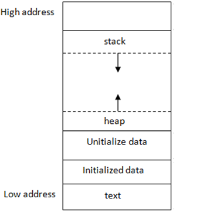
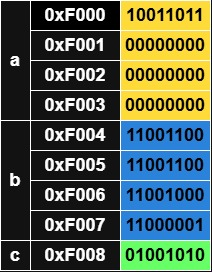
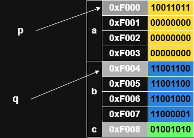
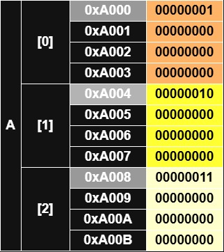
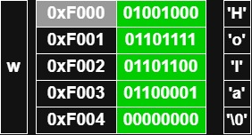
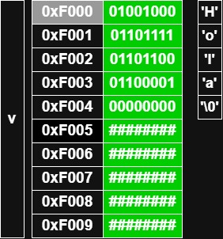

- [Tipos compuestos y punteros](#tipos-compuestos-y-punteros)
  - [Punteros](#punteros)
  - [Tipos de datos compuestos](#tipos-de-datos-compuestos)
    - [Arrays y vectores](#arrays-y-vectores)
    - [Struct](#struct)
    - [typedef](#typedef)
  - [Cadenas de caracteres](#cadenas-de-caracteres)
  - [Paso por referencia](#paso-por-referencia)


# Tipos compuestos y punteros

## Punteros



Toda variable local declarada en C, se almacena en una zona de memoria denominada <u>***pila (stack)***</u>. Cada una de esas variables tiene una dirección de memoria que permite localizarlas, y se conoce la primera dirección de memoria de TODA la zona de memoria que ocupa. Cada dirección de memoria ocupa exactamente **1 byte**. Entonces, si una variable ocupa varios bytes, estará guardada en varias direcciones de memoria consecutivas.

Por ejemplo, un entero ocupa 4 bytes, por lo tanto si el entero está guardado en la dirección `0x00` (recordemos que sólo nos dan la primera dirección de memoria de todas las que ocupa), sabemos que al ocupar 4 bytes ocupa desde la `0x00` hasta la `0x03`

```
[0x00] [0x01] [0x02] [0x03]
\_________________________/
      int x = 4 bytes
```

Veamos una representación gráfica de el almacenamiento en memoria de 3 variables con un ejemplo de código :

```c
int main() {
      int a = 155;
      float b = -25.1;
      char c = 'J';
}
```



El operador unario `&` permite conocer la dirección de memoria de una variable, como vimos en la [parte 1 de C](../C/1c.md#entrada-y-salida). También podemos obtener la dirección de memoria de una posición de un array o un campo del struct.

```c
int a = 5;
printf("Dirección de a : %p\n", &a);
```

Los <u>**punteros**</u> son variables que permiten almacenar direcciones de memoria. El puntero genérico es `void *`, pero podemos declarar punteros de cualquier tipo (`int *`, `double *`.... incluso arrays, matrices, estructuras...). Si escribimos un tipo distinto a void es porque sabemos que la dirección de memoria a la que apuntamos almacenamos ese tipo de dato.



```c
#include <stdio.h>

int main() {
      int a = 155;
      double b = -25.1;

      int *p = NULL;
      double *q = NULL;
      p = &a;
      q = &b;

      // siempre es buena práctica inicializar los punteros con NULL
      return 0;
}
```

Podemos modificar el valor contenido en la dirección de memoria que almacena el puntero :

```c
int a = 5; // a = 5
int *p = NULL;
p = &a;

*p = 6; // a = 6
```

Si un puntero apunta a una dirección de memoria <u>**no**</u> válida, podemos provocar una violación de segmento (<u>***segmentation fault/segfault***</u>), y si no se trata esta excepción, el SO termina la ejecución del programa de forma abrupta, generando un dumpeo de memoria (<u>***core dump***</u>)

```c
int main() {
      int *p = NULL;
      *p = 45; // segfault : estamos intentando escribir en una dirección de memoria inválida (0x0)
}
```

## Tipos de datos compuestos

### Arrays y vectores

- <u>**array**</u> $\rightarrow$ tipo de dato compuesto <u>**homogéneo**</u>. Una colección de elementos del mismo tipo indexados por un número entero.
- <u>**matriz**</u> $\rightarrow$ array multidimensional (un array de arrays), pudiendo crear matrices de más de 2 dimensiones.

Accedemos a los elementos de un array empezando desde 0.

```c
int main() {
      int vector[5];
      float matriz[2][3];

      int vector2[5] = {1,2,3,4,5};
      int matriz2[2][3] = {{1,2,3},{4,5,6}};

      vector[0] = matriz[1][2] + vector2[3];
}
```

> [!Note]
> La notación para declarar un vector entre llaves `int v[3] = {1,2,3};` sólo se puede hacer a la hora de la definición del vector, después no se puede.

```c
int main() {
      int a[3] = {1, 2, 3};
}
```



El operador `[]` permite 'saltar' al elemento siguiente del vector. Los saltos son del tamaño del tipo de datos. Un vector de enteros (32 bits), los saltos son de 4 en 4 bytes, en caracteres (8 bits), los saltos son de 1 en 1 byte...

Los arrays y los punteros se manejan de la misma forma, pudiendo usar el operador `[]` para indexar punteros : 

```c
int a[3] = {1,2,3};
int *p = NULL;
p = a;

*p = 6; // a[0] = 6
p[1] = p[1] + 1; // a[1] = 3
```

### Struct

Tipo de datos compuesto <u>**heterogéneo**</u> que permite combinar diferentes tipos de datos bajo un mismo tipo. Denominamos ***campo*** a cada uno de los elementos que lo forman :

```c
int main() {
      // definimos el struct 'Persona'

      struct Persona {
            char nombre[20];
            int edad;
      };

      struct Persona persona1; // declaramos la variable persona1 de tipo Persona
      persona1.edad = 25; // asignamos al campo 'edad' el valor 25
}
```

Podemos acceder a los campos de una variable declarada como 'struct' con el operador `.`

También podemos combinar tipos compuestos para formar tipos más complejos : 

```c
struct Persona {
      char nombre[20];
      int edad;
};

struct Grupo {
      struct Persona varias_personas[10];
      char nombre_grupo[20];
};
```

Si un puntero contiene la dirección de memoria de un struct, podemos acceder a los campos de este mediante el operador `->` :

```c
struct Punto {
      double x;
      double y;
};

Punto s;
Punto *p = NULL;

s.x = 1.5;
s.y = 3.1;

p = &s;
p->x = 1.5;
```

### typedef

utilizado para asignar un nombre alternativo a un tipo de dato existente, facilitando la creación de tipos de datos personalizados con nombres más descriptivos :

```c
typedef int Entero;
Entero num = 42;

typedef struct {
      char nombre[20];
      int edad;
} Persona;
```

## Cadenas de caracteres

Las cadenas de caracteres (<u>***Strings***</u>) en C son <u>arrays</u> de caracteres. Pueden declararse e inicializarse de diferentes maneas :

```c
int main() {
      char v[10];
      char w[] = "Hola"; // sólo se puede hacer esto en la inicialización.

      // para copiar Strings usamos 'strcpy'

      w = "Casa"; // ERROR
      strcpy(w, "Casa"); // Correcto (requiere el fichero de cabecera string.h)
}
```

> [!Note]
> Todas las cadenas de caracteres acaban por el caracter nulo `\0`. Por lo tanto para tratar cadenas, hay que asegurarse que el último caracter sea el caracter nulo.

Un String en memoria se vería tal que así : 

```c
char w[] = "Hola";
```



Aunque aparantemente w ocupa 4 bytes, realmente ocupa 5 por el caracter nulo del final. Puede darse el caso en el que la cadena ocupe menos del espacio total, en ese caso se rellenan con 0's el resto de posiciones : 

```c
char v[10] = "Hola";
```



## Paso por referencia