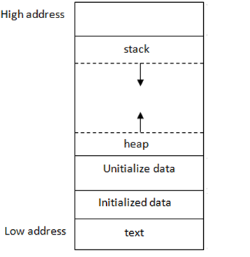
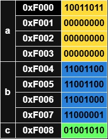
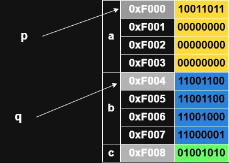
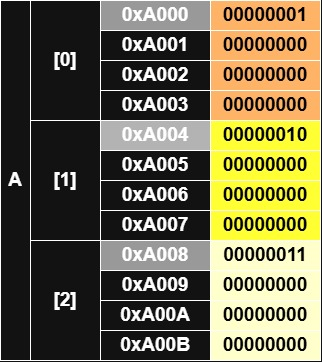
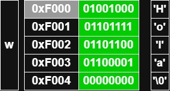
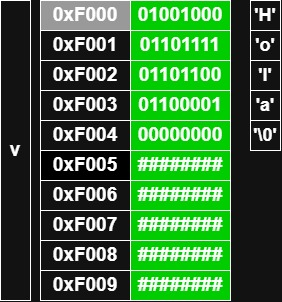

- [Tipos compuestos y punteros](#tipos-compuestos-y-punteros)
  - [Punteros](#punteros)
  - [Tipos de datos compuestos](#tipos-de-datos-compuestos)
    - [Arrays y vectores](#arrays-y-vectores)
    - [Struct](#struct)
    - [typedef](#typedef)
  - [Cadenas de caracteres](#cadenas-de-caracteres)
    - [atoi](#atoi)
    - [atof](#atof)
    - [strlen](#strlen)
    - [strcmp](#strcmp)
    - [strcpy](#strcpy)
    - [strcat](#strcat)
    - [strtok](#strtok)
    - [fgets](#fgets)
    - [sprintf](#sprintf)
    - [snprintf](#snprintf)
  - [Paso por referencia](#paso-por-referencia)
    - [Arrays](#arrays)
    - [Struct](#struct-1)


# Tipos compuestos y punteros

## Punteros



Toda variable local declarada en C, se almacena en una zona de memoria denominada <u>***pila (stack)***</u>. Cada una de esas variables tiene una dirección de memoria que permite localizarlas, y se conoce la primera dirección de memoria de TODA la zona de memoria que ocupa. Cada dirección de memoria ocupa exactamente **1 byte**. Entonces, si una variable ocupa varios bytes, estará guardada en varias direcciones de memoria consecutivas.

Por ejemplo, un entero ocupa 4 bytes, por lo tanto si el entero está guardado en la dirección `0x00` (recordemos que sólo nos dan la primera dirección de memoria de todas las que ocupa), sabemos que al ocupar 4 bytes ocupa desde la `0x00` hasta la `0x03`

```
[0x00] [0x01] [0x02] [0x03]
\_________________________/
      int x = 4 bytes
```

Veamos una representación gráfica de el almacenamiento en memoria de 3 variables con un ejemplo de código :

```c
int main() {
      int a = 155;
      float b = -25.1;
      char c = 'J';
}
```



El operador unario `&` permite conocer la dirección de memoria de una variable, como vimos en la [parte 1 de C](../C/1c.md#entrada-y-salida). También podemos obtener la dirección de memoria de una posición de un array o un campo del struct.

```c
int a = 5;
printf("Dirección de a : %p\n", &a);
```

Los <u>**punteros**</u> son variables que permiten almacenar direcciones de memoria. El puntero genérico es `void *`, pero podemos declarar punteros de cualquier tipo (`int *`, `double *`.... incluso arrays, matrices, estructuras...). Si escribimos un tipo distinto a void es porque sabemos que la dirección de memoria a la que apuntamos almacenamos ese tipo de dato.



```c
#include <stdio.h>

int main() {
      int a = 155;
      double b = -25.1;

      int *p = NULL;
      double *q = NULL;
      p = &a;
      q = &b;

      // siempre es buena práctica inicializar los punteros con NULL
      return 0;
}
```

Podemos modificar el valor contenido en la dirección de memoria que almacena el puntero :

```c
int a = 5; // a = 5
int *p = NULL;
p = &a;

*p = 6; // a = 6
```

Si un puntero apunta a una dirección de memoria <u>**no**</u> válida, podemos provocar una violación de segmento (<u>***segmentation fault/segfault***</u>), y si no se trata esta excepción, el SO termina la ejecución del programa de forma abrupta, generando un dumpeo de memoria (<u>***core dump***</u>)

```c
int main() {
      int *p = NULL;
      *p = 45; // segfault : estamos intentando escribir en una dirección de memoria inválida (0x0)
}
```

## Tipos de datos compuestos

### Arrays y vectores

- <u>**array**</u> $\rightarrow$ tipo de dato compuesto <u>**homogéneo**</u>. Una colección de elementos del mismo tipo indexados por un número entero.
- <u>**matriz**</u> $\rightarrow$ array multidimensional (un array de arrays), pudiendo crear matrices de más de 2 dimensiones.

Accedemos a los elementos de un array empezando desde 0.

```c
int main() {
      int vector[5];
      float matriz[2][3];

      int vector2[5] = {1,2,3,4,5};
      int matriz2[2][3] = {{1,2,3},{4,5,6}};

      vector[0] = matriz[1][2] + vector2[3];
}
```

> [!Note]
> La notación para declarar un vector entre llaves `int v[3] = {1,2,3};` sólo se puede hacer a la hora de la definición del vector, después no se puede.

```c
int main() {
      int a[3] = {1, 2, 3};
}
```



El operador `[]` permite 'saltar' al elemento siguiente del vector. Los saltos son del tamaño del tipo de datos. Un vector de enteros (32 bits), los saltos son de 4 en 4 bytes, en caracteres (8 bits), los saltos son de 1 en 1 byte...

Los arrays y los punteros se manejan de la misma forma, pudiendo usar el operador `[]` para indexar punteros : 

```c
int a[3] = {1,2,3};
int *p = NULL;
p = a;

*p = 6; // a[0] = 6
p[1] = p[1] + 1; // a[1] = 3
```

### Struct

Tipo de datos compuesto <u>**heterogéneo**</u> que permite combinar diferentes tipos de datos bajo un mismo tipo. Denominamos ***campo*** a cada uno de los elementos que lo forman :

```c
int main() {
      // definimos el struct 'Persona'

      struct Persona {
            char nombre[20];
            int edad;
      };

      struct Persona persona1; // declaramos la variable persona1 de tipo Persona
      persona1.edad = 25; // asignamos al campo 'edad' el valor 25
}
```

Podemos acceder a los campos de una variable declarada como 'struct' con el operador `.`

También podemos combinar tipos compuestos para formar tipos más complejos : 

```c
struct Persona {
      char nombre[20];
      int edad;
};

struct Grupo {
      struct Persona varias_personas[10];
      char nombre_grupo[20];
};
```

Si un puntero contiene la dirección de memoria de un struct, podemos acceder a los campos de este mediante el operador `->` :

```c
struct Punto {
      double x;
      double y;
};

Punto s;
Punto *p = NULL;

s.x = 1.5;
s.y = 3.1;

p = &s;
p->x = 1.5;
```

### typedef

utilizado para asignar un nombre alternativo a un tipo de dato existente, facilitando la creación de tipos de datos personalizados con nombres más descriptivos :

```c
typedef int Entero;
Entero num = 42;

typedef struct {
      char nombre[20];
      int edad;
} Persona;
```

## Cadenas de caracteres

Las cadenas de caracteres (<u>***Strings***</u>) en C son <u>arrays</u> de caracteres. Pueden declararse e inicializarse de diferentes maneras :

```c
int main() {
      char v[10];
      char w[] = "Hola"; // sólo se puede hacer esto en la inicialización.

      // para copiar Strings usamos 'strcpy'

      w = "Casa"; // ERROR
      strcpy(w, "Casa"); // Correcto (requiere el fichero de cabecera string.h)
}
```

> [!Note]
> Todas las cadenas de caracteres acaban por el caracter nulo `\0`. Por lo tanto para tratar cadenas, hay que asegurarse que el último caracter sea el caracter nulo.

Un String en memoria se vería tal que así : 

```c
char w[] = "Hola";
```



Aunque aparantemente w ocupa 4 bytes, realmente ocupa 5 por el caracter nulo del final. Puede darse el caso en el que la cadena ocupe menos del espacio total, en ese caso se rellenan con 0's el resto de posiciones : 

```c
char v[10] = "Hola";
```



Las funciones que trabajan con Strings no necesitan conocer su tamaño de forma explícita, porque se da por hecho que terminan en el caracter nulo `\0`

### atoi

```c
int atoi(const char *str);
```

Transforma un texto `"25"` en un número entero

- `str` : puntero que apunta a la primera dirección del string a transformar
- `int` : devuelve el número convertido a entero. Si no se ha podido realizar la conversión devuelve 0.

> [!Note]
> - Esta función omite todos los espacios en blanco al principio de la cadena, convierte los siguientes como parte del número y se para cuando encuentra el primero que no sea un número.
> - la declaración de un parámetro con `const char *` significa que el contenido al que apunta el puntero no se puede modificar.
> - para usar esta función necesitamos incluir la librerñía `<stdlib.h>`

### atof

```c
double atof(const char *str);
```

Transforma un texto `25.1` a un número real de doble precisión. Mismo funcionamiento que [atoi](./2c.md#atoi)

### strlen

```c
size_t strlen(const char *str);
```

Calcula la longitud de la cadena sin incluir el caracter final `'\0'`. Hay que incluir la librería `<string.h>`.

- `str` : puntero que apunta a la primera dirección del String.
- `size_t`: longitud de la cadena/String.

### strcmp

```c
int strcmp(const char *str1, const char *str2);
```

Compara dos cadenas de texto. Una cadena es inferior a otra si es anterior alfabéticamente. Hay que incluir la librería `<string.h>`.

- `str1` : puntero que apunta a la primera cadena a comparar
- `str2` : puntero que apunta a la segunda cadena a comparar
- `int` :
  - `< 0` $\rightarrow$ `str1 < str2`
  - `> 0` $\rightarrow$ `str1 > str2`
  - `= 0` $\rightarrow$ `str1 = str2`

### strcpy

```c
char *strcpy(char *dest, const char *src);
```

Copia una cadena de caracteres. Hay que incluir la librería `<string.h>`.

- `dest` : puntero a la cadena de destino donde copiaremos el contenido

> [!Important]
> La zona de memoria donde apunte el puntero debe ser válida (principalmente para evitar **`Segfault`**)

- `src` : puntero de la cadena a copiar 
- `char *` : devuelve el puntero a la cadena de destino (el destino de la copia va antes que el origen)

### strcat

```c
char *strcat(char *dest, const char *src);
```

Concatena dos strings (añade uno al final del otro).

- `dest` : puntero a la cadena destino, que debe contener un string y ser lo suficientemente grande para contener la cadena resultante concatenada.
- `src` : cadena que se va a añadir o concatenar.
- `char *` : devuelve un puntero a la cadena destino.

### strtok

```c
char *strtok(char *str, const char *delim);
```

Rompe la cadena en una serie de ***tokens*** usando un delimitador.

- `str` : este contenido se modifica y se divide en tokens (cadenas más pequeñas)
- `delim` : cadena que contiene el token (pueden variar de una llamada a otra)
- `char *` : puntero al token encontrado. Si no quedan tokens, devuelve un puntero nulo `NULL`.

> [!Note]
> Suele usarse un bucle while que irá invocando la función `strtok` hasta que la función devuelva `NULL`. Una vez modificada la cadena se puede perder su contenido.

### fgets

```c
char *fgets(char *str, int num, FILE *stream);
```

Puede leer una línea de texto desde un archivo o desde la entrada estándar (con `scanf` no se puede leer Strings con espacios)

- `str` : puntero al array donde se almacena la cadena leída.
- `num` : número máximo de caracteres a leer (incluyendo el carácter nulo)
- `stream` : puntero al fichero a leer.
- `char *` : retorna un puntero a la cadena de caracteres a leer si tiene éxito o `NULL` en caso de error o alcance del final del archivo.

> [!Note]
> Todavía no hemos visto ficheros, pero pueden usarse tres archivos especiales (flujos de datos) para leer entrada estándar y escribir en la salida estándar y estándar de error : 
> - `stdin` : entrada estándar (teclado por defecto)
> - `stdout` : salida estándar (terminal por defecto)
> - `stderr` : salida estándar de errores (terminal por defecto)

```c
char buffer[100];
fgets(buffer, 100, stdin);
```

Similar el funcionamiento de `fprintf`

```c
fprintf(stdout, "Hola mundo\n");
```

Y también existe la función `fscanf`

### sprintf

```c
int sprintf(char *str, const char *format, ...);
```

imprime datos formateados en un string de caracteres de forma similar a `printf` y `fprintf`

- `str` : puntero del string donde guardaremos la cadena formateada (necesitamos asignar memoria previamente de manera estática o dinámica)
- `format` : cadena de formato que funciona igual que en `printf` y `fprintf`
- `...` : lista de argumentos variables que serán formateados según la cadena de formato.
- `int` : devuelve el número de caracteres escritos en el string final (sin contar `\0`)

```c
char buffer[50];
int num = 42;
double pi = 3.14159;
int lon = sprintf(buffer, "num : %d\npi : %.2f", num, pi);

printf("Cadena : %s\n", buffer);
printf("Longitud : %d\n", lon);
```

### snprintf

```c
int snprintf(char *str, size_t size, const char *format, ...);
```

similar a `sprintf` pero ahora con un tamaño limitado.

- `str` : puntero al string donde guardaremos la cadena formateada (debemos asginar memoria previamente)
- `size` : tamaño máximo del string (incluyendo `\0`)
- `format` : cadena de formato
- `...` : lista de argumentos variables que serán formateados según la cadena de formato.
- `int` : número de caracteres que habrían sido escritos si no hubiera restricciones de tamaño (sin incluir `\0`). Si el número es >= a size, la salida se trunca.

## Paso por referencia

En C, **TODOS** los parámetros siempre se pasan <u>**por copia**</u> (a diferencia de Java por ejemplo que podemos pasar parámetros por valor). El paso por referencia requiere el uso de **punteros**.

```c
void suma_uno(int a) {
      a = a + 1;
}

void main() {
      int a = 1; // 1
      suma_uno(a);
      printf("%d\n", a); // 1
}
```

Como se puede observar en el código, la variable a de `suma_uno(int a)` es diferente de la del `main`, y es por eso que al aplicar el procedimiento el valor de la variable no cambia (dos direcciones diferentes y almacenadas en diferentes pilas). Si queremos modificar el valor de `a` realmente, tenemos que pasarle la dirección de memoria (con punteros) y cambiar el valor almacenado en esa dirección :

```c
void suma_uno(int *a) {
      *a = *a + 1; // aquí cambiamos el valor almacenado en la dirección de a
}

void main() {
      int a = 1; // 1
      suma_uno(&a);
      printf("%d\n", a); // 2
}
```

### Arrays

> [!Note]
> Los arrays siempre se pasan por referencia, pues lo que pasamos de un array es la dirección de memoria del primer elemento.

```c
int suma_vector(int v[], int tam) { // también se puede escribir 'int suma_vector(int *v, int tam) ...'
      int suma = 0;
      for (int i = 0; i < tam; i++) {
            suma += v[i];
      }
      return suma;
}
```

> [!Important] 
> En C no hay una función como tal que devuelva el tamaño de un vector. Si necesitamos el tamaño de un vector, debemos pasarlo como parámetro.

### Struct

> [!Note]
> Los `Struct` se pasan por copia en C. Para evitar duplicidad de estructuras y aprovechar memoria, es recomendable pasarlos por referencia.

```c
typedef struct {
      double x;
      double y;
} Punto;

void suma_puntos(Punto *a, Punto *b, Punto *c) {
      c->x = a->x + b->x;
      c->y = a->y + b->y;
}
```
