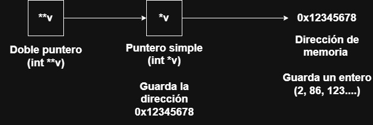
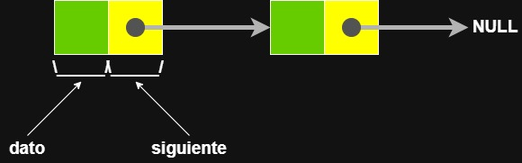

- [Memoria dinámica](#memoria-dinámica)
  - [malloc](#malloc)
  - [sizeof](#sizeof)
  - [free](#free)
  - [calloc](#calloc)
  - [realloc](#realloc)
- [Aritmética de punteros](#aritmética-de-punteros)
- [Punteros dobles](#punteros-dobles)
- [Listas enlazadas](#listas-enlazadas)


# Memoria dinámica

Si no conocemos el tamaño de un array a priori, podemos hacer dos cosas :

- **Sobredimensionarlo** :

```c
int main() {
    int a[1000];
}
```

- **hacer la declaración una vez conocido el tamaño** :

```c
int main() {
    int tam = 0;
    printf("Introduce el tamaño : ");
    scanf("%d", &tam);
    int a[tam];
}
```

Estas variables se almacenan en la pila, por lo que si sus valores son muy grandes, podemos provocar un desbordamiento de pila (***stack overflow***) y provocar una violación de segmento (***segfault***). Además, hasta que termina la ejecución de la función, la memoria sigue ocupada incluso si no se usa.

Para reservar memoria de forma dinámica en C, lo hacemos con la función `malloc` (***<u>M</u>emory <u>ALLOC</u>ation***). Todas las funciones que vamos a ver a continuación requieren la librería `<stdlib.h>`

## malloc

```c
void *malloc(size_t size)
```

- `size` : especifica el tamaño en **bytes** de la memoria que queremos reservar/alojar.
- `void *` : retorna el puntero al inicio del bloque de memoria si se ha podido reservar y sino devuelve `NULL`.

La memoria reservada no se encuentra en la pila, sino en el montículo (***<u>heap</u>***), y el ciclo de vida no se limita al ciclo de vida de la función como ocurre en la pila (***<u>stack</u>***)

## sizeof

Macro que sirve para calcular el tamaño de un tipo de datos (también podemos calcular el tamaño de un tipo de datos definido por el propio usuario)

> [!Note]
> El tamaño puede depender de la arquitectura de cada procesador

```c
typedef struct {
    double x;
    double y;
} Punto;

int main() {
    printf("Tamaño de un double (en mi ordenador) : %lu\n", sizeof(double)); // 8
    printf("Tamaño de un Punto (en mi ordenador) : %lu\n", sizeof(Punto)); // 16
}
```

El ***<u>heap</u>*** es una región de memoria que se utiliza para que los datos persistan más allá del alcance de la función que los creó. Tanto asignación como liberación de memoria se realiza explícitamente por el programador

## free

Esta función se usa para liberar la memoria utilizada cuando ya no se utilice para evitar fugas de memoria (***<u>memory leak</u>***). Se le pasa como parámetro el puntero de la primera dirección de la memoria a liberar (la que devuelve `malloc`, `calloc` o `realloc`)

```c
#define TAM 4

int main() {
    int * p = NULL;
    p = malloc(sizeof(int) * TAM);

    free(p);
    p = NULL;

    return 0;
}
```

---

Podemos combinar `malloc` y `sizeof` para crear arrays de enteros por ejemplo :

```c
#define TAM 4

int main() {
    int * v = NULL;
    v = malloc(sizeof(int) * TAM);
    
    if (v != NULL) {
        for (int i = 0; i < TAM; i++) {
            v[i] = i;
        }
        free(v); // liberamos memoria
    } else {
        fprintf(stderr, "Error asignando memoria.\n");
    }
    return 0;
}
```

## calloc

Asigna bloques de memoria inicializados a 0 ('**limpios**'). Bastante parecida a malloc. Bastante útil cuando se trabaja con arrays y queremos inicializarlos a 0.

```c
void *calloc(size_t nmemb, size_t size);
```

- `nmemb` : nº de elementos a reservar.
- `size` : tamaño de cada elemento. En `malloc` es un único parámetro : `malloc(nmemb * size)`.
- `void *` : retorna el puntero al primer bloque de memoria asignada.

## realloc

Utilizado para cambiar el tamaño de un bloque de memoria previamente asignado. Puede usarse para expandir o reducir un bloque de memoria previamente asignado.

```c
void *realloc(void *ptr, size_t size);
```

- `ptr` : puntero al bloque de memoria existente.
- `size` : nuevo tamaño deseado.
- `void *` : puntero al inicio del nuevo bloque de memoria (puede ser la misma dirección o diferente)

# Aritmética de punteros

La aritmética sobre punteros nos permite operar sobre la dirección de memoria contenida en una variable de tipo puntero.

Al sumar o restar un 1 a un puntero, desplazamos por la memoria el puntero en unidades del tamaño apuntado (para enteros se desplaza 4 unidades, para caracteres se desplaza 1 unidad...) :

> [!Note]
> Sólo se suma 1, no 4. C se encarga automáticamente de desplazar las unidades necesarias para avanzar al siguiente elemento del array

```c
int main() {
    int *p = NULL;
    int arr[] = {1, 2, 3, 4, 5};

    p = arr;

    printf("%d\n", *p); // 1

    p += 1;

    printf("%d\n", *p); // 2
}
```
> [!Important]
> El siguiente código muestra error :

```c
#include <stdio.h>

int main() {
    int *p = NULL;
    p = malloc(sizeof(int) * 10); // p = 0x100 por ejemplo

    if (p != NULL) {
        for (int i = 0; i < 10; i++) {
            p[i] = i * 10;
        }
        for (int i = 0; i < 10; i++) {
            printf("Elemento %d : %d\n", i, *(p++));
        }
        // p = 0x128 = 0x120 + 40 = 0x120 + 4*10
    }

    free(p); // ERROR. Queremos liberar la dirección que ha retornado malloc (0x100), 
    // pero estamos liberando 0x140 (da error)
}
```

Para solucionar este error tenemos que crear dos punteros, los dos que apunten a la dirección que devuelve malloc pero que SÓLO UNO se modifique.

# Punteros dobles



Los dobles punteros no son más que punteros que guardan la dirección de memoria de otro puntero (un puntero que apunta a otro puntero).

```c
#include <stdio.h>

int main() {
    int **v = NULL;
    int *p = NULL;
    int arr[] = {1,2,3,4,5};

    p = arr;
    v = &p;

    *p = 6; // cambiamos el primer elemento del vector
    *(*v + 1) = 7; // cambiamos el segundo elemento del vector
    
    for (int i = 0; i < 5; i++) {
        printf("%d\n", arr[i]);
    }

    // 6 7 3 4 5
}
```

Es un concepto complicado, pero realmente es bastante sencillo. En el ejemplo anterior, con un puntero podemos cambiar el valor de las posiciones del vector, y con dobles punteros, como apuntan a un puntero que a su vez apunta a un array, implica que el doble puntero apunta indirectamente al array.

Los dobles punteros se suelene utilizar para modificar un puntero desde dentro de una función (paso por referencia y no por copia)

# Listas enlazadas

Una ***Lista enlazada*** es una estructura de datos <u>**dinámica**</u> compuesta por nodos. Cada nodo está compuesto por :

- **valor** 
- **referencia al siguiente nodo**

Hay dos tipos de listas enlazadas :

- **simplemente enlazadas** $\rightarrow$ cada nodo sólo apunta al siguiente.
- **doblemente enlazadas** $\rightarrow$ cada nodo apunta tanto al siguiente nodo como al anterior.

Este tipo de listas permite la inserción y eliminación de elementos de forma eficiente, especialmente si el tamaño de la colección cambia dinámicamente.

<br>



```c
typedef struct Nodo {
    int dato;
    struct Nodo *sig;
} Nodo;
```

Podemos definir diferentes punteros para gestionar una lista de forma eficiente :

- ***cabeza*** : permite el acceso rápido al inicio de la lista.
- ***final*** : este puntero al final de la lista facilita la inserción de nuevos elementos al final.
- ***recorrido*** : el puntero de recorrido permite desplazarse por la lista para buscar o modificar nuevos elementos.

```c
#include <stdio.h>
#include <stdlib.h>

typedef struct Nodo {
    int dato;
    struct Nodo *siguiente;
} Nodo;

int main() {
    // con malloc reservamos memoria para los dos nodos de la lista en el Heap
    Nodo *cabeza = malloc(sizeof(Nodo));
    Nodo *segundo = malloc(sizeof(Nodo));

    // lo siguiente que haremos será rellenar los datos y enlazarlos
    cabeza->dato = 10;
    cabeza->siguiente = segundo;
    segundo->dato = 20;
    segundo->siguiente = NULL; // el último Nodo SIEMPRE apunta a NULL

    free(segundo);
    free(cabeza); // para terminar, es importante que liberemos la memoria utilizada por los nodos de la lista para evitar fugas de memoria

    return 0;
}
```

Otras operaciones que podemos realizar es insertar un elemento al final por ejemplo, borrar un elemento y sustituirlo por otro...