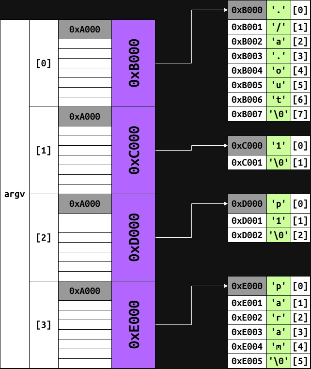

# Parámetros de main

Para procesar parámetros de entrada, debemos declarar la función main de la siguiente forma :

```c
#include <stdio.h>

int main(int argc, char *argv[]) {
// int main(int argc, char **argv) ...
    return 0;
}
```

- `argc` : entero que representa el nº de parámetros
- `argv` : array de tamaño ***argc*** que contiene punteros a char (punteros a cadenas de caracteres). Estos strings son los parámetros que se han introducido (incluido el nombre del ejecutable)

Si ejecutamos un programa en C con los siguientes parámetros :

`./a.out 1 p1 param`

tendremos que : 

```
argc = 4
argv[0] = dirección del string "./a.out"
argv[1] = dirección del string "1"
argv[2] = dirección del string "p1"
argv[3] = dirección del string "param"
```

